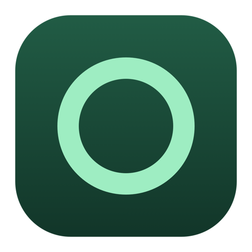
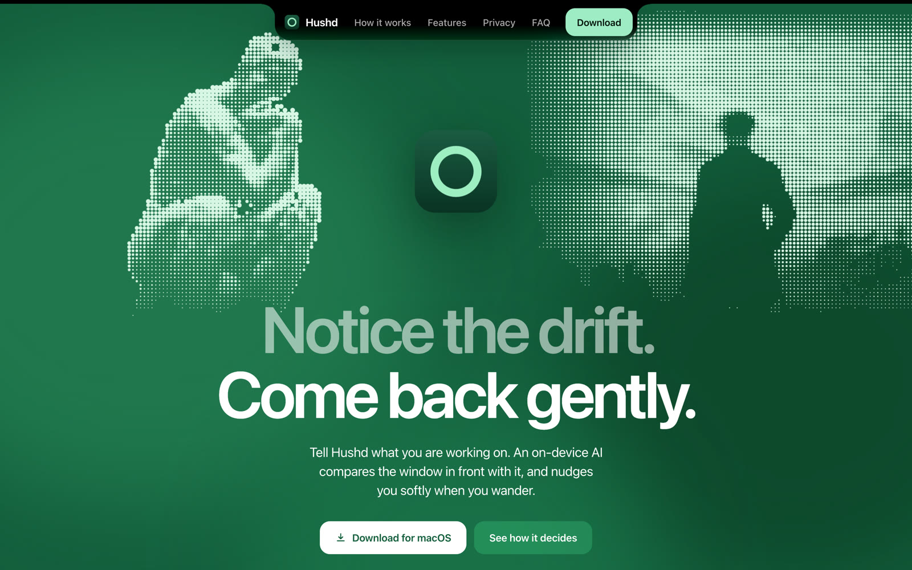
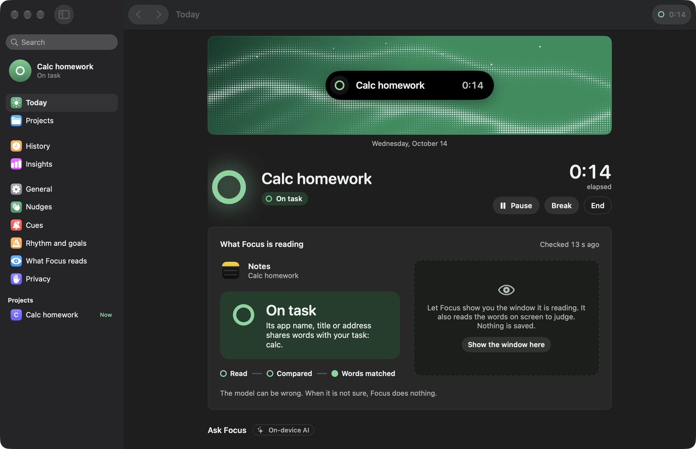
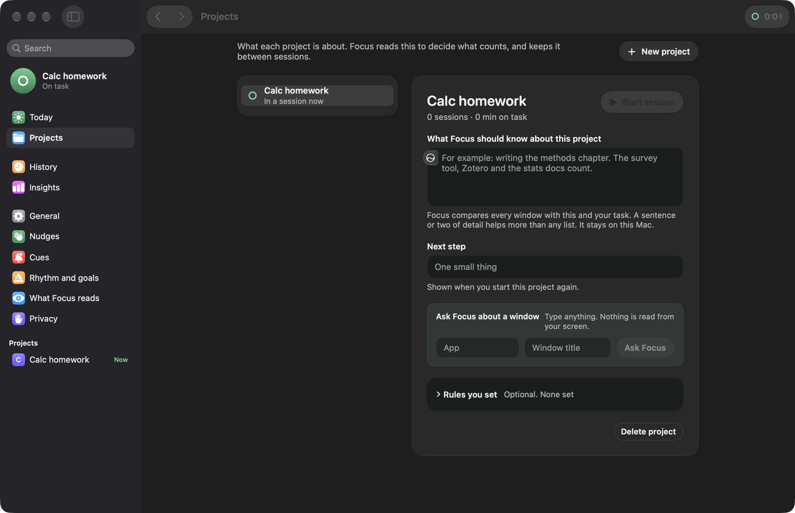
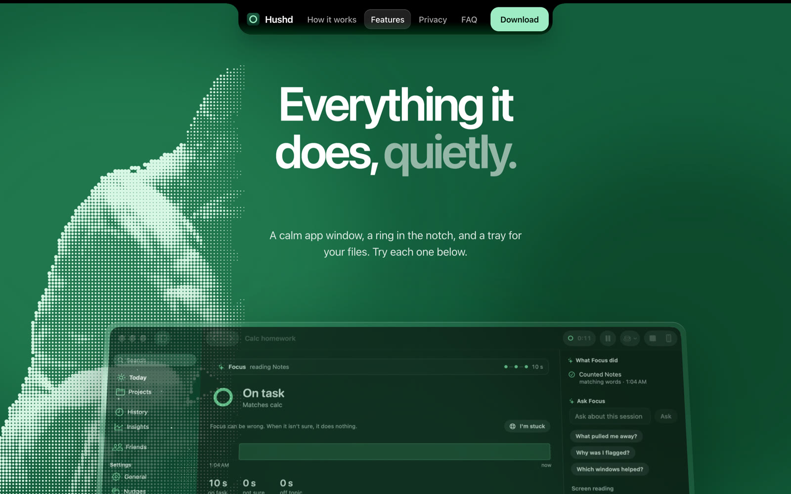
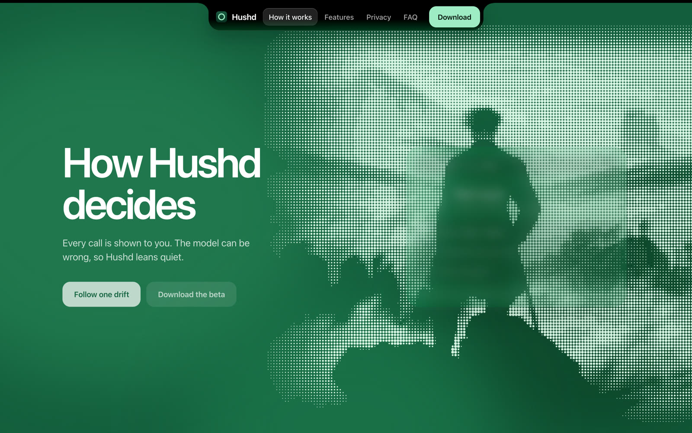

<p align="center">
  
</p>

<h1 align="center">Hushd</h1>

<p align="center">
  <b>Notice the drift. Come back gently.</b><br>
  The website for Hushd, a macOS focus app that lives in your notch.
</p>

<p align="center">
  <a href="https://focus-mac.lovable.app"><b>Visit the site</b></a>
  &nbsp;·&nbsp;
  <a href="https://focus-mac.lovable.app/how-it-works">How it works</a>
  &nbsp;·&nbsp;
  <a href="https://focus-mac.lovable.app/features">Features</a>
</p>

<p align="center">
  
  
  
  
</p>

<p align="center">
  
</p>

---

## About Hushd

You tell Hushd what you're working on. An on-device AI compares the window in front of you with that task, and when you wander off it nudges you softly from the Mac's notch. There's no account and no cloud model, and the judging runs on your Mac.

This repo is the marketing site: five animated pages that explain the app and let you try its interactions in the browser before downloading.

<table>
  <tr>
    <td width="50%"></td>
    <td width="50%"></td>
  </tr>
  <tr>
    <td align="center"><sub>Today: the current task, time elapsed and what the app is reading right now</sub></td>
    <td align="center"><sub>Projects: a sentence about the work beats any list of rules</sub></td>
  </tr>
</table>

## What's on the site

| Page | What it shows |
|---|---|
| **Home** | The pitch, plus a live notch demo that reads a window, decides *on task / not sure / drifting* and nudges you back |
| **How it works** | Follow one drift step by step, with the Gentle, Standard and Strict modes |
| **Features** | Interactive demos: the notch ring, project memory, Back to task, the file tray, the `⌃⌥F` shortcut, screen reading and the iPhone companion |
| **Privacy** | What Hushd reads, what it never reads, and how long anything stays in memory |
| **Download** | The macOS beta |

<p align="center">
  
</p>

<p align="center">
  
</p>

## Tech stack

- React 19 with TanStack Start and TanStack Router
- Vite, TypeScript and Tailwind CSS 4
- Radix UI primitives
- Built and deployed with [Lovable](https://lovable.dev). Pushes to `main` sync back to the editor.

## Running locally

```sh
bun install
bun run dev
```

---

<p align="center">
  Built for the Congressional App Challenge by <a href="https://github.com/aaravmuthu">Aarav Muthu</a> and <a href="https://github.com/Aryan61056">Aryan</a>
</p>
